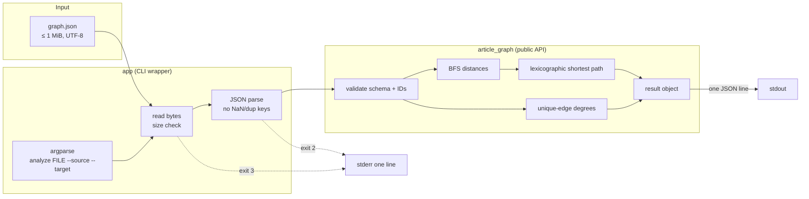

# offline-article-graph

Offline directed article graph analysis from a local JSON snapshot. Given a
fictitious article graph, the tool reports the shortest link path between two
articles, the set of articles reachable from a source, and the in/out degree of
every article.

This is the v0.1 subset of the original "Wikipedia Graph Explorer" idea
(idea #60): no crawler, no online Wikipedia access, no graphical interface and
no centrality or floating-point metrics. Difficulty: simple; primary interface:
library (`article_graph`), with a thin command-line wrapper (`app`).

- Product version: **0.1.0**
- Spec version: **0.1.4** (see the issue that produced this repository)
- Platform: **POSIX — Ubuntu and macOS** (native Windows is out of scope)
- Runtime: **Python 3.12**, standard library only

## Quickstart

The repository is importable from its root without installation and has no
runtime dependencies. From the repository root:

```sh
python app --version
# offline-article-graph 0.1.0

cat > graph.json <<'JSON'
{"nodes":["A","B","C","D"],"edges":[["A","B"],["A","C"],["B","D"],["C","D"]]}
JSON

python app analyze graph.json --source A --target D
# {"path":["A","B","D"],"reachable":["A","B","C","D"],"degrees":[{"id":"A","in":0,"out":2},{"id":"B","in":1,"out":1},{"id":"C","in":1,"out":1},{"id":"D","in":2,"out":0}]}
```

`./app` and `python app` are equivalent (the file is executable and has a
shebang). The tool is read-only: it never modifies `graph.json` and creates no
state or cache files.

Library use:

```python
from article_graph import analyze

graph = {"nodes": ["A", "B"], "edges": [["A", "B"]]}
result = analyze(graph, "A", "B")
print(result)
# {'path': ['A', 'B'], 'reachable': ['A', 'B'], 'degrees': [{'id': 'A', 'in': 0, 'out': 1}, {'id': 'B', 'in': 1, 'out': 0}]}
```

## Graph format

A graph is an exact JSON object (extra fields are invalid):

```json
{"nodes": ["A", "B"], "edges": [["A", "B"]]}
```

- `nodes`: JSON array of 0..1000 unique IDs. An ID is an ASCII string matching
  `[A-Za-z0-9_-]{1,32}` (32 characters valid, 33 invalid). Duplicate IDs are
  invalid, not deduplicated.
- `edges`: JSON array of 0..10000 records; each record is an array of exactly
  two IDs that already appear in `nodes`. Loops are allowed. Repeated edges are
  deduplicated and do not affect degrees, reachability or paths.
- The empty graph `{"nodes": [], "edges": []}` is a valid schema, but every
  query fails because the source and target cannot exist.

In the Python API, `nodes` and `edges` must be Python `list` objects (tuples are
invalid), and source/target must be existing ASCII IDs. Invalid input raises
`ValueError`; the function performs no I/O (including network access) and never
mutates its arguments.

## Result

```json
{"path":["A","B"],"reachable":["A","B"],"degrees":[{"id":"A","in":0,"out":1},{"id":"B","in":1,"out":0}]}
```

- `path`: the unweighted directed shortest path as a list of IDs. Among equally
  short paths, the lexicographically smallest **sequence** wins, compared
  element by element in ASCII order (IDs are never concatenated). `source ==
  target` yields `[source]`. With no path, the API returns `None` and the CLI
  emits JSON `null` (never the string `"null"`).
- `reachable`: every node reachable from `source`, including `source`, sorted in
  ASCII order.
- `degrees`: every node, sorted by ID, as an exact object
  `{"id":"A","in":0,"out":1}`. A loop contributes one to `in` and one to `out`
  of the same node; duplicate edges contribute once.

Results are independent of nodes/edges ordering. No floating-point metric or
centrality ranking exists in v0.1.

## CLI

```text
usage: app [-h] [--version] COMMAND ...

commands:
  analyze FILE --source ID --target ID

options:
  --help     show this help message and exit
  --version  show the product version and exit
```

- `python app --version` prints exactly `offline-article-graph 0.1.0` followed
  by LF, with exit code 0 and empty stderr.
- `python app --help` prints usage and every command/option, exit code 0 and
  empty stderr.
- `python app analyze FILE --source ID --target ID` reads `FILE` (at most
  1 MiB = 1048576 bytes, inclusive, measured before parsing including
  whitespace) and prints one line of JSON followed by LF.
- On success stdout contains only data and stderr is empty.
- On error stdout is empty and stderr is one line starting with `error:`
  (no traceback).
- Exit codes: `2` for unknown/missing arguments, invalid JSON, invalid schema,
  invalid IDs, unknown IDs and files above the size limit; `3` for I/O failures
  such as a missing file, an unreadable file or a directory passed as `FILE`.
- UTF-8 input without BOM, LF-terminated text output. Unicode and spaces in
  paths are supported.

No HTTP server exists in this version; the HTTP rules of the parent spec do not
apply to this library/CLI deliverable.

## Limits

| Limit | Value |
| --- | --- |
| Nodes per graph | 1000 (inclusive) |
| Edge records per graph | 10000 (inclusive) |
| ID characters | 1..32, ASCII `[A-Za-z0-9_-]` |
| Input file size | 1048576 bytes (inclusive) |
| Runtime dependencies | none (standard library only) |
| Python | 3.12 |

## Platform

POSIX only: Ubuntu and macOS. CI runs on `ubuntu-latest` and `macos-latest` with
Python 3.12 and `PYTHONUTF8=1`. Native Windows (and `app.cmd`) is explicitly
outside the scope of this version.

## Testing and linting

One documented command for the public tests:

```sh
python -m unittest discover -s tests -v
```

Tests are black-box: the library is used only through the documented public API
(`from article_graph import analyze`), and the CLI is exercised through
`subprocess` using `sys.executable`. Test names are traceable to the acceptance
criteria (AC-1..AC-12). The tests use temporary directories per test and
ephemeral state only; no network is used. The application has no write path, so
a persisted-JSON write-failure fixture is not applicable — the read-only
contract is covered by the "input file is not modified" test.

Linting and formatting (pinned in `requirements-dev.txt`):

```sh
python -m pip install -r requirements-dev.txt
python -m ruff check .
python -m ruff format --check .
```

## Architecture



## Decisions

- **Standard library only.** `unittest` covers tests; `ruff` is the pinned dev
  linter/formatter. There is no setup script and no packaging step, because
  there are no runtime dependencies; `article_graph` is importable from the
  repository root.
- **Library is the primary interface.** The CLI is a thin validator/parser plus
  a call to `analyze`, guaranteeing AC-12 (identical structures).
- **Validation before analysis.** Every schema, ID, count and membership check
  runs before any result is computed; inputs are never mutated.
- **Deterministic output.** Distances come from BFS; among equal-length paths a
  layered dynamic program keeps the lexicographically smallest path per node at
  its minimum distance. Sorting uses ASCII (Python code-point) order, which
  matches ASCII for the allowed ID alphabet.
- **Inclusive limits.** 1000 nodes, 10000 edge records, 32-character IDs and
  1048576-byte files are accepted; one more is rejected.
- **Errors are machine-friendly.** One `error:` line, no traceback, empty
  stdout; I/O is exit 3 and content/argument errors are exit 2.
- **Read-only by design.** No caches, no state files, no temporary files — so
  there is nothing to persist atomically and no write-failure surface.

## How this was built

- **Stage:** implementation of SPEC v0.1.4 (issue #1) on 2026-11-16.
- **Authorship:** implementation and public tests were written by an AI agent
  (Claude Code harness). The model reported by the runtime for this run was
  `deepseek-flash`. The maintainer is responsible for the tag/release after
  merge and for recording any human edits or corrections.
- **Independence:** the public tests in `tests/` were authored in the same agent
  session as the implementation, so they are not a model-family-independent
  black-box suite. An independent hidden test suite authored by a different
  model family is governed by the parent portfolio process and is not included
  here; this repository makes no claim about its results.
- **Corrections:** this implementation was developed against the spec and the
  public acceptance criteria only; the normative audit resolutions are recorded
  in `tests/AMBIGUIDADES.md`. No future results, tags, releases or external
  submissions are claimed by this document.

## License

MIT, 2026. See [LICENSE](LICENSE).
